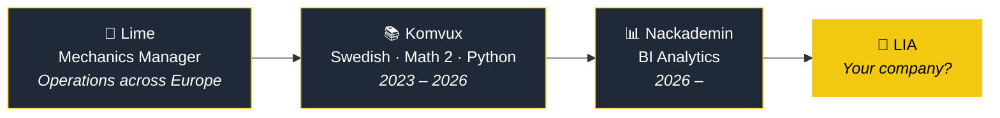

<!-- ===== HEADER ===== -->
<p align="center">
  
</p>

<p align="center">
  
</p>

<p align="center">
  <a href="https://www.linkedin.com/in/erik-belo"></a>
  <a href="mailto:belo.erik@hotmail.com"></a>
  
</p>

---

### 🧮 About me

```dax
Erik =
VAR Background  = "Mechanics Manager @ Lime, supporting markets across Europe"
VAR NowLearning = "Business Intelligence Analytics @ Nackademin"
VAR Speaks      = "Catalan · Spanish · English · Swedish"
VAR Superpower  = "I've run the operations the dashboards are about"
RETURN
    "Turning operational data into decisions people actually use"
```

---

### 🛣️ My career



---

### 🧰 Toolbox

<p>
  
  
  
  
  
  
</p>

---

### 📊 Featured projects

| | Project | The question | Built with |
|---|---|---|---|
| 🥩 | [**Himalaya Kött & Video**](https://github.com/ErikBenalcazar/himalaya-powerbi-report) | How are sales and staff performing in a retail business? | Power BI · DAX |
| 🚲 | **AdventureWorks BI Report** *(link coming)* | How are sales, staff, inventory and finances performing? | Power BI · DAX |
| 🏠 | **Airbnb Market Analysis** *(link coming)* | Which accommodation should a company offer in European cities? | Power BI |

---

<p align="center">
  <i>"I've managed the operations behind the KPIs. Now I build the dashboards that drive them."</i>
</p>

<p align="center">
  
</p>
